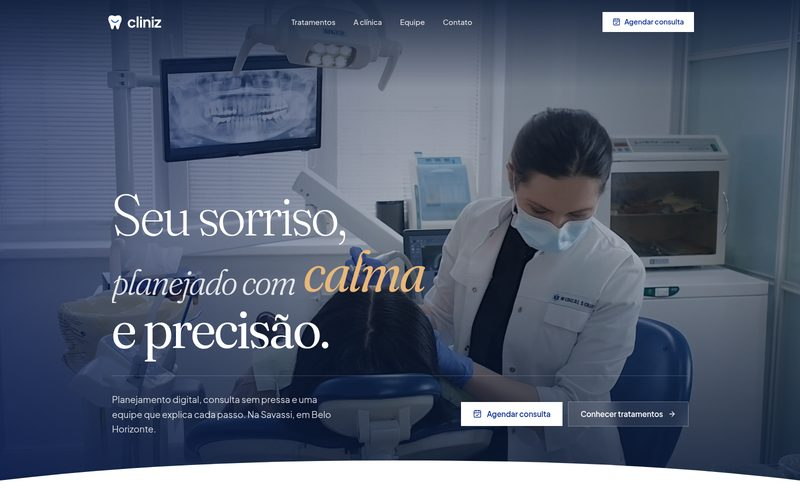
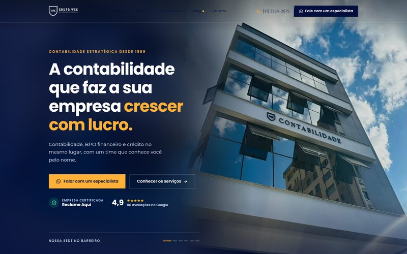
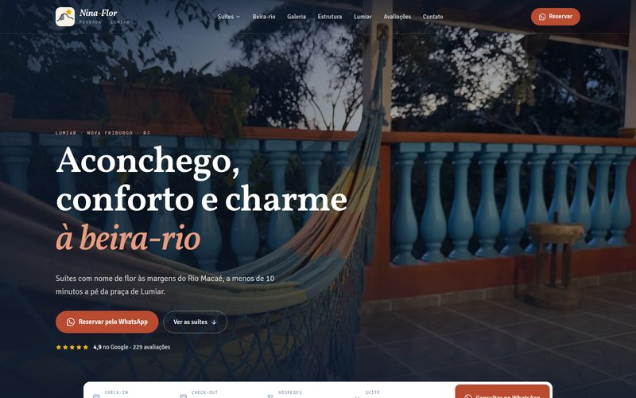
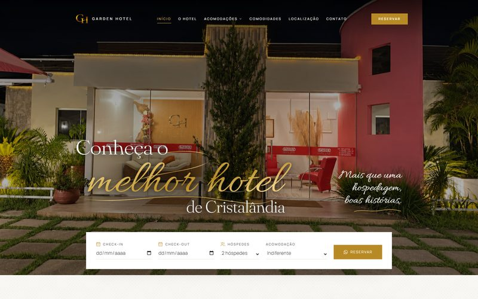
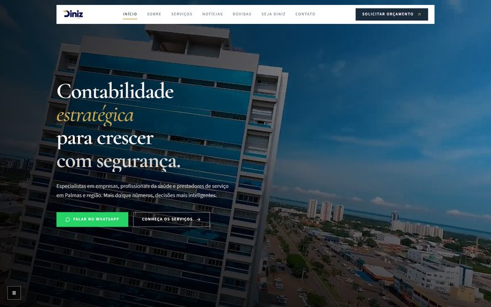
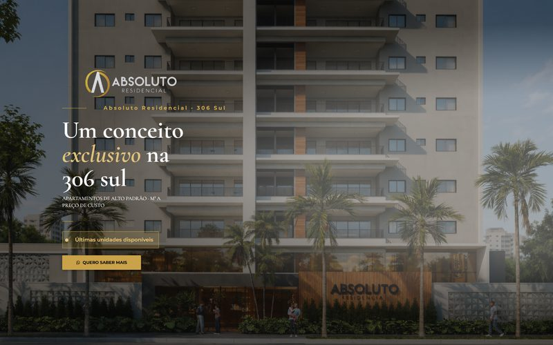

# Rafael Silva Diniz

**Backend Developer · C# & .NET**

Information Systems @ UNITINS · Software Development Intern @ CIGMA · Palmas, Tocantins 🇧🇷

Building web systems and digital experiences for real businesses, from the database to the last pixel.

 

 

## About

I'm an Information Systems student and Software Development Intern on [**CIGMA**](https://cigma.to.gov.br/), a platform for environmental data and geographic intelligence for the state of Tocantins.

My core is the backend: **C#, .NET, ASP.NET Core, GraphQL and PostgreSQL**. I also design, build and ship full-stack products with **React, Next.js and TypeScript**, and have worked with **Java (Quarkus)** and **Angular**.

Outside the internship I work independently through [**rafaeldiniz.dev**](https://www.rafaeldiniz.dev), delivering websites and management systems for clinics, accounting firms, law firms, hotels and sports clubs. Every project below is live and in use.

 

## Featured · Palmas Judô Clube

<table>
<tr>
<td width="58%">

</td>
<td width="42%" valign="top">

**Management system + public website**

The club's daily operations in one place: **student records, class attendance and monthly payments**, alongside the public site where new students book a trial class.

`Sports club` · `2025`

[**Visit the project →**](https://www.palmasjudoclube.com.br/)

</td>
</tr>
</table>

 

## Projects in production

<table>
<tr>
<td width="50%" valign="top">

 <b><a href="https://www.cliniz.com.br/">Cliniz Odontologia</a></b>
 Website + online booking · Dental clinic · 2026
</td>
<td width="50%" valign="top">

 <b><a href="https://www.wsccontabilidade.com.br/">WSC Contabilidade</a></b>
 Website + content dashboard · Accounting · 2026
</td>
</tr>
<tr>
<td width="50%" valign="top">

 <b><a href="https://www.pousadaninaflor.com.br/">Nina-Flor Pousada</a></b>
 Website with booking flow · Hospitality · 2026
</td>
<td width="50%" valign="top">

 <b><a href="https://www.plenusgestaofinanceira.com.br/">Plenus Gestão Financeira</a></b>
 Institutional website · Financial BPO · 2026
</td>
</tr>
<tr>
<td width="50%" valign="top">

 <b><a href="https://www.nexuswebsolutions.com.br/">Nexus Web Solutions</a></b>
 Landing page · Marketing agency · 2026
</td>
<td width="50%" valign="top">

 <b><a href="https://www.gardenhotelcristalandia.com.br/">Garden Hotel Cristalândia</a></b>
 Hotel website · Hospitality · 2025
</td>
</tr>
<tr>
<td width="50%" valign="top">

 <b><a href="https://pactuscontabilidade.com.br/">Pactus Contabilidade</a></b>
 Institutional website · Accounting · 2025
</td>
<td width="50%" valign="top">

 <b><a href="https://www.dinizcontabilidade.com/">Diniz Contabilidade</a></b>
 Institutional website · Accounting · 2025
</td>
</tr>
<tr>
<td width="50%" valign="top">

 <b><a href="https://moreiradelmiroadvocacia.com.br/">Moreira Delmiro Advocacia</a></b>
 Institutional website · Law firm · 2025
</td>
<td width="50%" valign="top">

 <b><a href="https://absolutoresidence.com.br/">Absoluto Residence</a></b>
 Landing page · Real estate · 2024
</td>
</tr>
</table>

See case studies, process and more on <a href="https://www.rafaeldiniz.dev"><b>rafaeldiniz.dev</b></a>

 

## Stack

<table>
<tr>
<td width="140"><b>Backend</b></td>
<td></td>
</tr>
<tr>
<td><b>Frontend</b></td>
<td></td>
</tr>
<tr>
<td><b>Data & infra</b></td>
<td></td>
</tr>
</table>

 

## Currently going deeper on

- ASP.NET Core and Entity Framework Core
- Database modeling and SQL performance
- Automated testing
- Docker and software architecture
- Cloud computing and technical English

 

<picture>
  <source media="(prefers-color-scheme: dark)" srcset="https://raw.githubusercontent.com/rafaelsdiniz/rafaelsdiniz/output/github-snake-dark.svg">
  
</picture>

  

**Have a project in mind?** [Let's talk →](mailto:rafaeldiniz.rsd@gmail.com)

